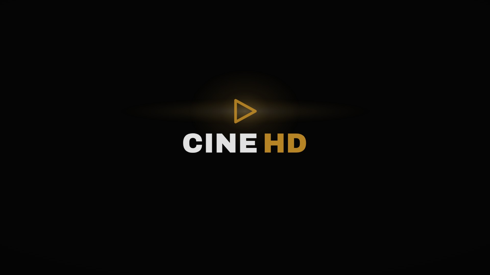
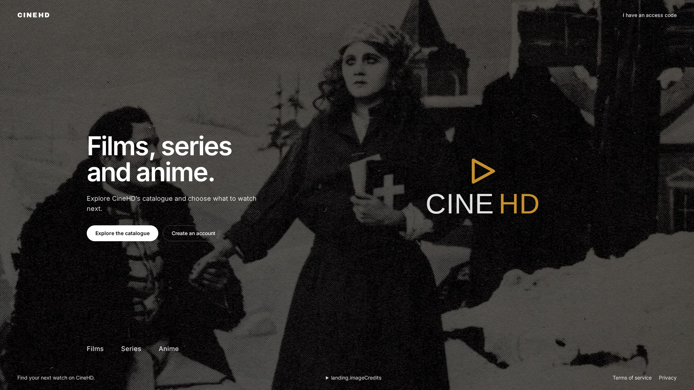
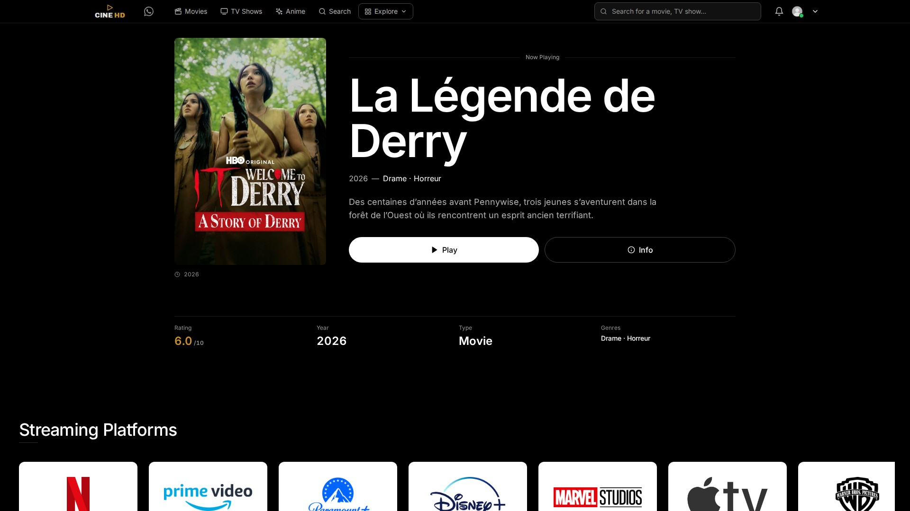
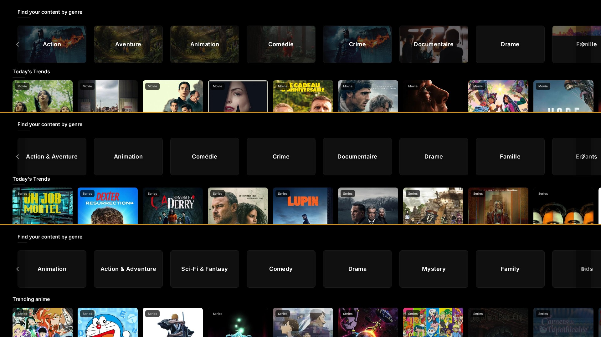
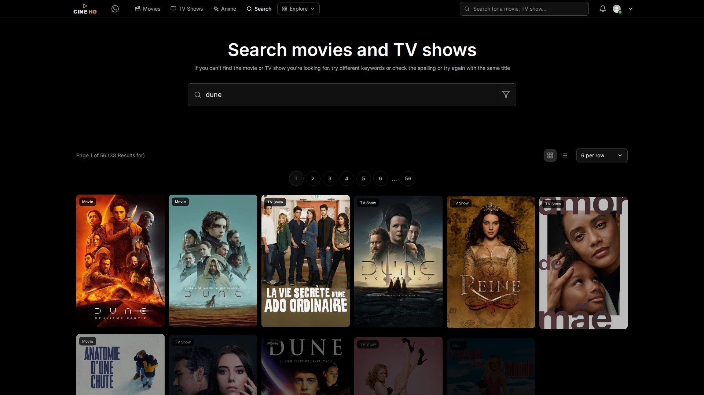
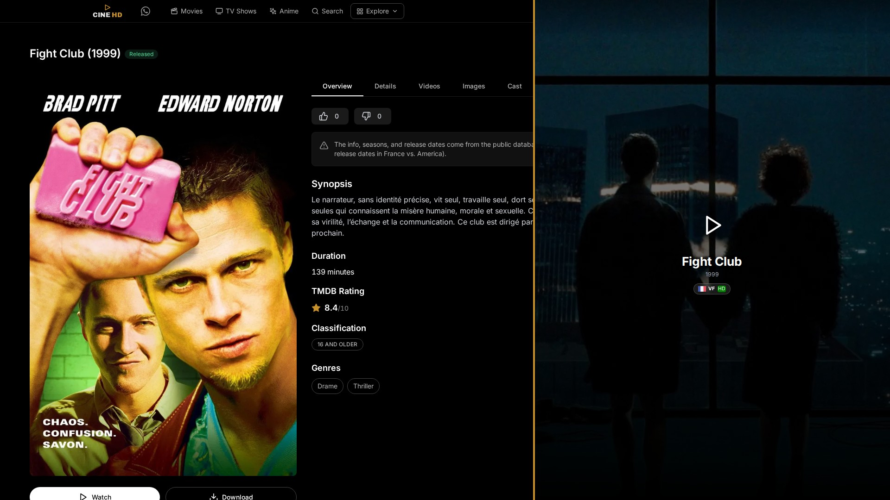
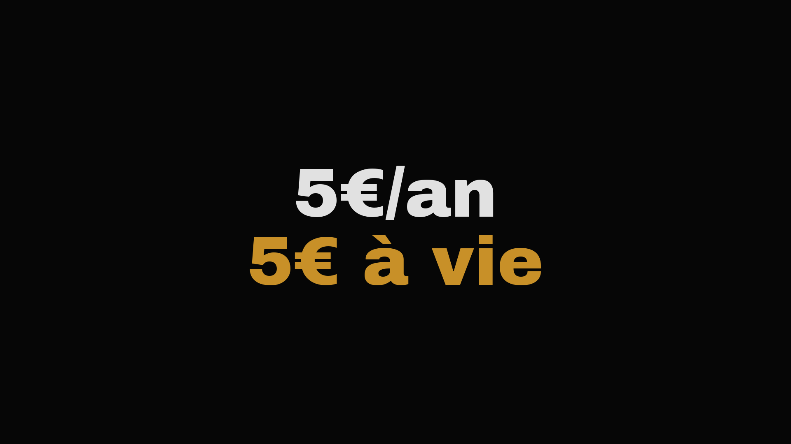
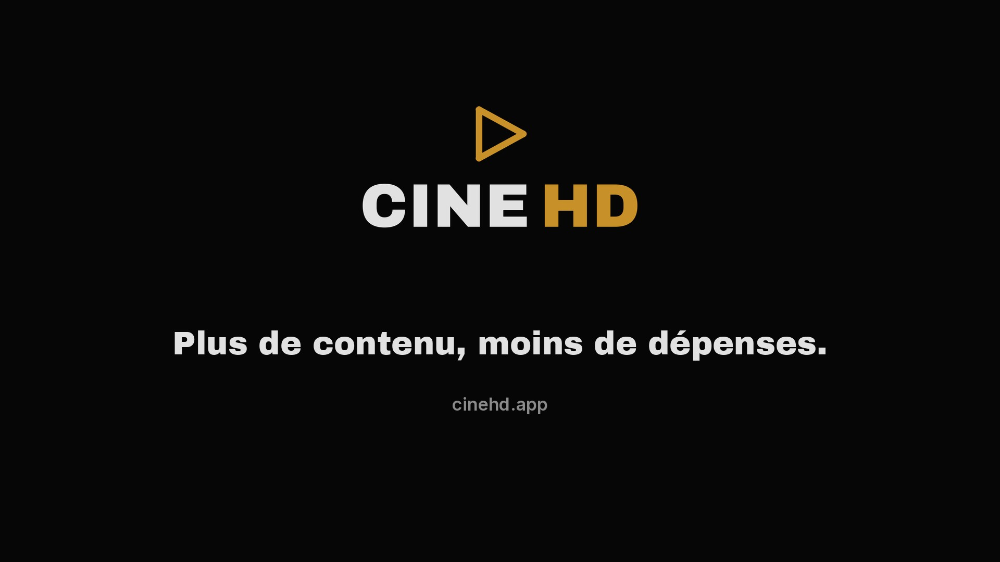

# Launch Film — Phase 3 : Storyboard

> **Status:** ⏸️ awaiting your approval (Phase 4 gate)
> **Frames:** `docs/launch-film/storyboard/s01…s08` — 1920×1080, composed **only** from real captures + real copy + brand fonts. Composite frames (s04, s06) mark cuts with 4 px `#C89028` seams; no seam appears in the film itself, it *is* the transition.
> **Concept:** « ALLUMAGE » (approved Phase 2) — *trace → flood → resolve*.

---

## Beat map (45 s)

```
0s          4.5s        9s          15s              24s    29s        35s     40s   45s
├─ S1 ──────┼─ S2 ──────┼─ S3 ──────┼──── S4 ────────┼─ S5 ─┼─ S6 ─────┼─ S7 ──┼─ S8 ─┤
│ L'allumage│ Le rideau │ Chez toi  │ Le mur         │Trouve│ Joue     │ Le prix│Outro │
│ slow held │ push      │ nav sweep │ fast → faster  │ snappy│  PEAK   │  STOP  │resolve
                                    films→séries→anime      playback  5€ silence wordmark
```

---

## S1 — L'allumage · 0.0–4.5 s



| | |
|---|---|
| **Source** | `scene01-cinematic-1250ms.png` — the **real** loading-screen lockup peak (666 gold px), untouched |
| **Motion** | The app's own `.cgp-*` CSS timeline replayed under a controlled clock: white trace draws the triangle → gold floods → lockup resolves → the loader's **real** dissolve at ~1500 ms **match-cuts** into S2's first frame (the white flash becomes the landing's light) |
| **Text** | none — the wordmark is the text |
| **Sound** | projection-room hush; one warm sub-drop **on** the gold flood |
| **Transitions** | in: from black · out: real dissolve / match-cut |

## S2 — Le rideau · 4.5–9 s



| | |
|---|---|
| **Source** | `02-landing.png` — real landing, untouched |
| **Motion** | Slow push `1.00→1.05`, expo-out. The gold line (transition *a*) draws along the bottom edge and wipes the nav in |
| **Text** | real `landing.title` / `landing.subtitle` **in FR** (« Films, séries et anime. ») — production re-capture in FR, see note ① |
| **Sound** | music bed enters, quiet |
| **Transitions** | in: match-cut from S1 · out: trait d'or (a) |

## S3 — Chez toi · 9–15 s



| | |
|---|---|
| **Source** | `03-home.png` — real home, Derry hero, untouched |
| **Motion** | The real nav's gold underline sweeps Accueil→Films (real hover states); two façade pushes (b) between real nav states |
| **Text** | the hero as the app renders it (FR: « Regarder » / « Plus d'infos »); section title « Populaire sur CineHD » as UI |
| **Sound** | a soft tick per nav move |
| **Transitions** | in: trait d'or · out: façade (b) |
| **Framing** | hero + nav only — the frame **never** shows the platforms-logo row below (note ③) |

## S4 — Le mur · 15–24 s *(the kinetic centerpiece)*



| | |
|---|---|
| **Source** | bottom bands (genres + poster rows) of `04-movies` / `06-tv-shows` / `07-anime` — **39 real posters** |
| **Motion** | three stacked walls travel horizontally at speed (blur on travel only, posters land sharp), accelerating: films → séries → anime; one poster per wall steps forward at each seam |
| **Text** | real nav labels as small captions (FR: Films · Séries · Anime) |
| **Sound** | whoosh per wall, beat-synced, quickening |
| **Transitions** | in: façade (b) · out: zoom (c) into the chosen poster |

## S5 — Trouve · 24–29 s



| | |
|---|---|
| **Source** | `08-search.png` — real search, 38 real results for « dune » |
| **Motion** | the real query types itself (replayed input), results cascade in grid |
| **Text** | the real query + the app's own result count (as UI) |
| **Sound** | soft key ticks + one « landing » hit when the grid fills |
| **Transitions** | in: zoom (c) · out: trait d'or (a) |

## S6 — Joue · 29–35 s *(the peak)*



| | |
|---|---|
| **Source** | `05-movie-details.png` (real fiche) + `10b-playback-signedin.png` (**real player, signed-in session**, captured this phase — replaces the anonymous sign-in wall, see note ②) |
| **Motion** | zoom (c): into the real « Regarder » button → out into the player; the gold triangle punctuation lands on the play button (2nd and last use of the zoom) |
| **Text** | real buttons (FR: « Regarder » / « Plus d'infos »); the player's own title + VF/HD badge as UI |
| **Sound** | **PEAK** — click, room tone opens, music full |
| **Transitions** | in: trait d'or · out: hard cut to near-black |

## S7 — Le prix · 35–40 s *(the stop)*



| | |
|---|---|
| **Source** | designed card — brand face (Archivo Black) on the real `#060606`; **only** the two verified strings: « 5€/an » (white) then « 5€ à vie » (gold) |
| **Motion** | near-still; each price fades up as the music ducks. No strikethroughs, no countdowns, no urgency — the honesty is the flex |
| **Sound** | hard duck to near-silence; one warm note under the gold line |
| **Transitions** | in: hard cut · out: the gold line re-traces and carries into S8 |

## S8 — Tout s'allume · 40–45 s



| | |
|---|---|
| **Source** | lockup **rendered from the real vector geometry** (`CineHDWordmark.tsx`: viewBox 495×222, triangle `M218,28…`, `#C89028` w9, Archivo Black 86) + your slogan + real domain |
| **Motion** | lockup resolves with a slow gold breath; the trace line from S7 closes the film to black |
| **Text** | wordmark · « Plus de contenu, moins de dépenses. » · `cinehd.app` |
| **Sound** | warm resolve, fade with the black |
| **Transitions** | in: gold-line carry · out: black |

---

## Production notes (found while composing — honest inventory)

① **Locale:** all Phase-1/2 captures rendered the app in **EN** (the app reads its own language setting, not the browser's). The film is French-primary → Phase 5 re-captures every scene with the app language set to FR. The storyboard shows framing; final text will be the real FR strings.

② **S6 playback capture:** the original `10-playback-wall.png` was shot logged-out and shows the sign-in wall (the playback gate). This phase re-captured the watch page with a real app session (BIP39 flag — the same session state every other authenticated capture used): the real player now shows title, play button, VF/HD badge. Clicking play reaches the provider's stream-search state; the film **stops on the ready-to-play frame** — actual film footage is third-party copyrighted and never appears. Provider corner watermarks are cropped out by the film's framing.

③ **Third-party logos:** the home page contains a real « Streaming Platforms » row (Netflix, Prime Video, etc.). Real app content, but the film frames only the hero — no competitor/platform logos appear in the film.

④ **App bug spotted (unrelated to the film):** the landing footer renders the raw i18n key `▶ landing.imageCredits` instead of translated text. Flagged for a separate fix; the film frames around it.

⑤ **Verified claims:** only the two S7 prices may appear. No Top 10 (empty in dev → never shown). No other offer, anywhere.

---

## Deliverables status

| Phase 1 asset | Status |
|---|---|
| 46 verified captures + inventory | ✅ `/tmp/opencode/launch-film/assets/` |
| Storyboard frames ×8 (this doc) | ✅ `docs/launch-film/storyboard/` |
| Compose script (reproducible) | ✅ `/tmp/opencode/launch-film-compose-storyboard.py` |
| Signed-in playback re-capture | ✅ `10b/10c/10d-playback-*.png` (`/tmp/opencode/launch-film-recap-playback.js`) |

## Music — chosen and analyzed (option a: your track)

**Track:** `Tiakola - Mode de vie.mp3` (190.7 s, 44.1 kHz stereo, **136 BPM**) — path recorded in `docs/launch-film-phase3-storyboard.md` §Music.

**Why it fits (measured, not guessed):**
- The track opens **quiet for its first ~5 s** — exactly the projection-room hush S1 needs; the sub-drop lands in that silence.
- Energy then **builds steadily 5→28 s** and hits its **first peak at ~28–30 s** — aligned with S6 (the playback peak, 29–35 s).
- Beat grid: 136 BPM → **1 beat = 0.441 s, 1 bar = 1.765 s**. In production, scene cuts snap to this bar grid (±0.5 s nudges inside the 40–50 s budget).

**Edit plan (Phase 5):** one continuous excerpt from the track's top (no splices — the natural arc already mirrors the film): hush under S1 → bed enters at S2 → build through S4/S5 → full at S6 → **hard duck** under S7 (volume automation, ~80 % down) → warm resolve/fade over S8.

> ⚠️ **Rights note:** this reads as a commercial release (Tiakola, Warner-signed), not a royalty-free library track. You provided it, so the choice is yours — but if the film publishes publicly, confirm you hold the sync rights for it, or we swap to a licensed alternative before export.

**Still needed from you:** approval of this board (8 frames above) → Phase 4 gate → Phase 5 scene-by-scene production.
